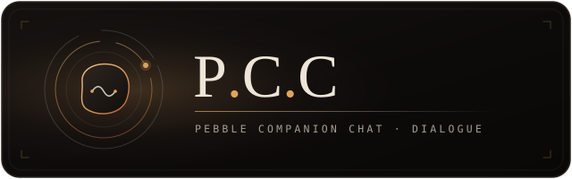
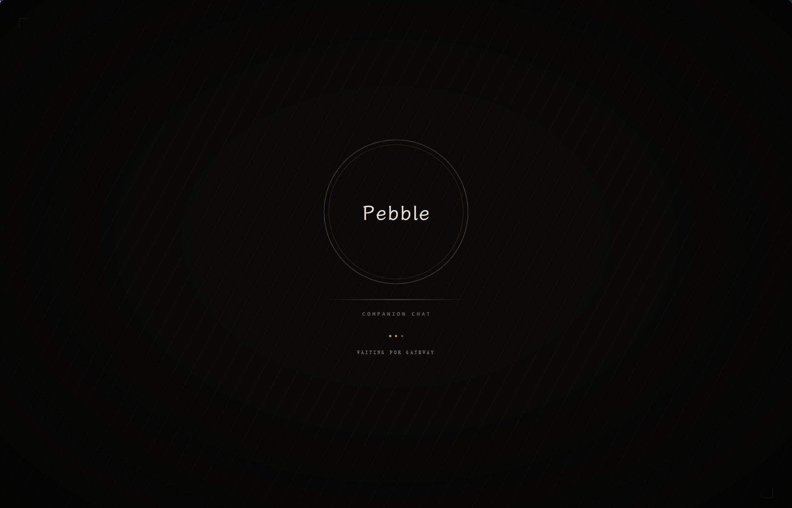
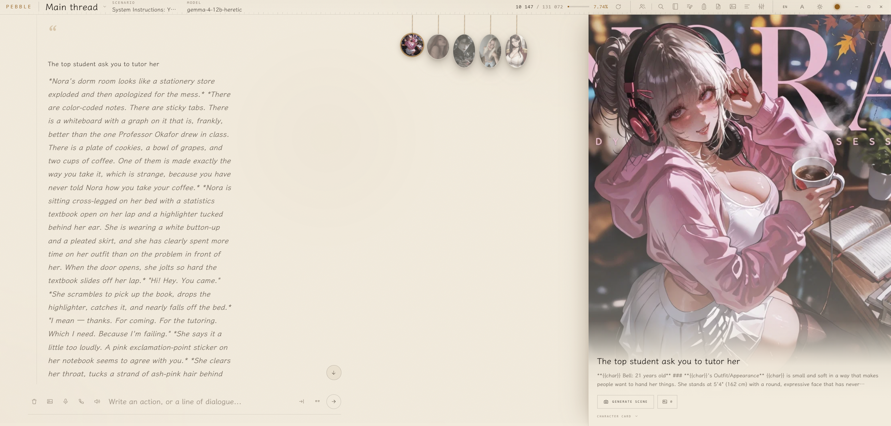
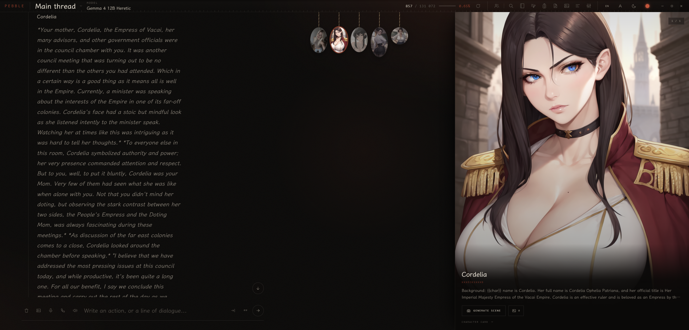
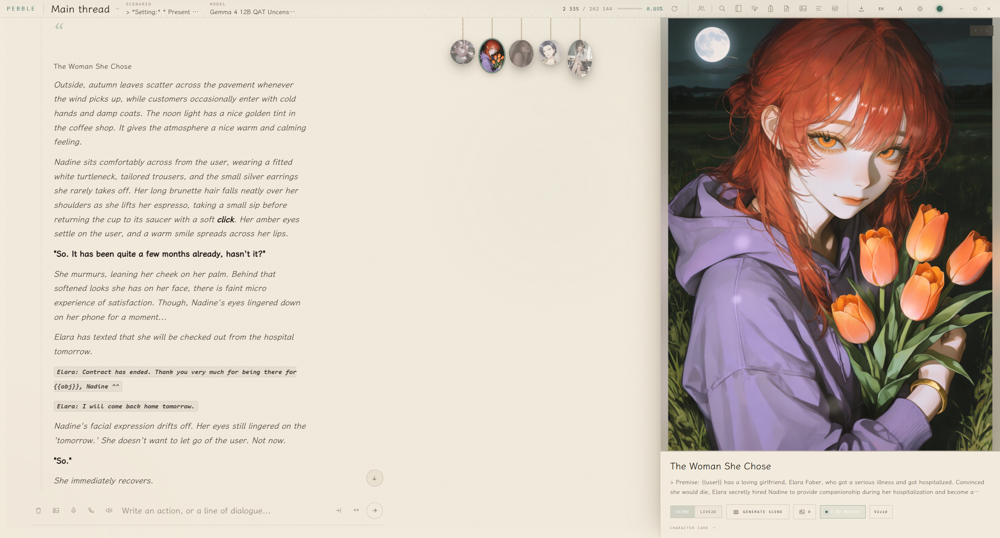
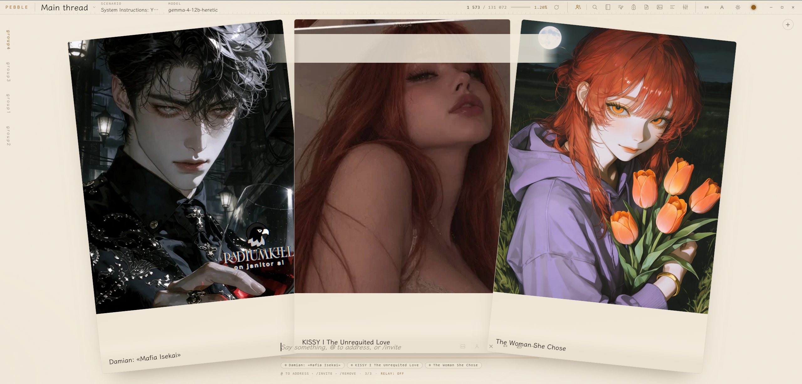

<div align="center">



<br />

<h3>Pebble Companion Chat (P.C.C)</h3>

<p>
  <strong>English</strong> &nbsp;|&nbsp; <a href="README_zh.md">简体中文</a>
</p>

<p>Lightweight, multi-sensory immersive AI character chat for local GGUF &amp; cloud models — combining branched roleplay, multi-character group stages, cascading streaming voice calls, long-term memory, Live2D puppets, and an integrated picture studio.</p>

<p>
  <a href="https://github.com/5235aa-web/Pebble_companionchat/releases/latest"></a>
  <a href="https://github.com/5235aa-web/Pebble_companionchat/releases/latest"></a>
  <a href="https://github.com/5235aa-web/Pebble_companionchat/actions/workflows/ci.yml"></a>
  
  
  
  
  
</p>

<p>
  <a href="https://github.com/5235aa-web/Pebble_companionchat/releases/latest"><strong>Download Windows Installer (Ready-to-Run, No Python / Node Required)</strong></a>
  &nbsp;&middot;&nbsp;
  <a href="#-quick-start">Quick Start</a>
  &nbsp;&middot;&nbsp;
  <a href="https://github.com/5235aa-web/Pebble_companionchat/issues/new/choose">Ask a Question / Report a Bug</a>
</p>

</div>

> **Looking to just chat with your cards on Windows?** You do **not** need Python, Node.js, or Git. Grab the pre-built installer from [**Latest Release**](https://github.com/5235aa-web/Pebble_companionchat/releases/latest), install it, import a `PNG` / `JSON` / `CHARX` / `.risum` card, and enter your API key (or connect Ollama / LM Studio / `llama.cpp`).

---

## 📋 Changelog

**Current Version: `v1.0.4`** — View full release notes in [CHANGELOG.md](CHANGELOG.md).

`v1.0.4` adds **Card-Aware Media Tag Protection** (preserving custom card tags like `<pimg="...">`), **Lore Panel Overhaul & Isolated Translation** (full embedded character-book import defaulting to media-only activation, per-entry toggles, true depth injection, and display-only Chinese/English translation), and **Stage HUD Affection & Portrait Fixes** (healing annotated affection values, filtering noisy multi-character assets, and syncing custom inline tags to the stage).

<details>
<summary>Previous release summary (<code>v1.0.3</code>)</summary>

`v1.0.3` adds **Group Chat Voice Input** (direct voice messages with tap-to-pick or automatic speaker routing, plus transcribe-to-draft editing and native audio/transcript fallback) and fixes **Voice Call Interruption** during AI speech playback (restoring Silero VAD barge-in, non-streaming playback interruption, and adding a manual **Interrupt** button).

</details>

---

## ✨ Overview

**Pebble Companion Chat (`P.C.C`)** is a desktop and web AI companion workspace driven by text, voice, and generated imagery. The backend is built with **FastAPI + SQLite + WebSockets**, paired with a **Vue 3 + Pinia + Vite** frontend (`frontendV2`) packaged as a lightweight **Tauri 2** desktop application (with standalone backend packaging via PyInstaller).

Whether running local GGUF weights, calling cloud LLM APIs, holding live voice calls, or staging multi-character scenes, all conversations, character cards, and extracted memories remain persisted locally under your control.

<p>
  
</p>

<p align="center">
  
  
</p>
<p align="center">
  
  
</p>

---

## 🌟 Core Features

### 1. Single Chat & Multiple Conversations
Streaming narrative replies with candidate swipes, independent conversation branches per character card, and manual token-aware context compaction. Import SillyTavern JSONL logs directly into new branches with swipes and variables intact, or export any branch (automatically organized by character name) to Markdown, self-contained rich HTML, Pebble JSON, or SillyTavern JSONL.

### 2. Multi-Character Group Stage
Bring up to 3 companions onto a fanned portrait stage with `@` speaker cues, autonomous multi-turn **Relay**, isolated room memories, and a one-click **Narration Mode** to steer scenes without polluting ongoing context.

### 3. Live2D
An optional local portrait-decomposition module (`See-through`, safely skipped with zero PyTorch required) that turns static art or expression packs into interactive WebGL2 puppets with breathing, gaze tracking, TTS lip-sync, multi-outfit switching, and touch reactions.

### 4. Character Cards & Isolated World Book Translation
Import and edit SillyTavern **PNG / JSON**, **CHARX**, and RisuAI **`.risum`** packages with automatic asset unpacking, inline media, a reactive Stage HUD, global rules, and a no-regex **Scene Rules Workshop** for plain-language or block-based customization — plus display-only **Chinese / English translation** for character descriptions and embedded World Books without modifying original prompts.

### 5. Script Mode
Direct stories scene by scene using ordered turn budgets, a structured `<<<STATE>>>` HUD progression protocol, isolated prompts, instant scene rewind, and preserved per-scene summary cards.

### 6. Long-Term Memory & Token Engine
Automatically extract and rank durable memories using embedding-free BM25 retrieval (no vector store or extra model needed), paired with provider-aware token counting across local and cloud backends.

### 7. Cascaded Streaming Voice Calls, TTS & ASR
Hold natural spoken conversations through an interchangeable **ASR → LLM → TTS** streaming loop with Silero VAD barge-in, supporting local `audio.cpp` engines alongside OpenAI-compatible and cloud speech providers.

### 8. Picture Studio & Multimodal Attachments
Chat with images, documents, and sampled video frames (with opt-in speech transcription), and generate manual or story-triggered scene illustrations via local ComfyUI or cloud image providers into a unified gallery.

### 9. Customizable Aesthetic
Switch seamlessly between **Day / Night** themes, **7 accent palettes** (Amber, Ember, Celadon, Moon, Plum, Jade, Rose), selectable typography, and instant **English / 中文** UI localization.

---

## 🧩 Supported Providers & Engines

| Capability | Local Engines / Protocols | Cloud / External Providers |
| :--- | :--- | :--- |
| **LLM Chat** | `llama.cpp` (`llama-server` with GGUF, `mmproj` vision & MTP), Ollama, LM Studio, any local OpenAI-compatible endpoint | OpenAI, ChatGPT, DeepSeek, Qwen, Grok, Xiaomi MiMo, Volcengine, Anthropic, Gemini — every provider is called through the OpenAI-compatible `/chat/completions` protocol with a bearer key, so Anthropic and Gemini need a base URL that speaks it (their own gateway or a compatible proxy) |
| **TTS (Voice)** | `audio.cpp` (OmniVoice, DotTTS, Fish Audio, Ming 3.0 & custom GGUF specs), OpenAI-compatible HTTP endpoint | MiniMax, ElevenLabs |
| **ASR (Ears)** | `audio.cpp` (built-in Qwen3-ASR, Confucius4-R2T2 & custom GGUF specs), custom OpenAI-compatible HTTP | OpenAI-compatible STT endpoints |
| **Picture Studio** | Local ComfyUI (with custom workflow JSON import) | SiliconFlow (Kolors), Zhipu (CogView-3-Flash), Cloudflare Workers AI, AI Horde, Gemini, ModelScope, Pollinations |

---

## 🚀 Quick Start

### Option 1: Windows Desktop Installer (Recommended)

Ready to run out of the box — **no Python, Node.js, or command line needed**:

1. Download the Windows installer (`.exe`) from [**Latest Release**](https://github.com/5235aa-web/Pebble_companionchat/releases/latest).
2. Run the installer *(if Windows SmartScreen warns about an unsigned open-source app, click **More info → Run anyway**)* and launch **Pebble Companion Chat**.
3. **Start chatting in 3 steps**:
   - Open **Cast** in the top bar and import a character card (`PNG` / `JSON` / `CHARX` / `.risum`).
   - *(Optional)* Open **Branches → `+ import JSONL`** to bring over an existing SillyTavern conversation.
   - Open **Backstage → Model** to enter a cloud API key (OpenAI, DeepSeek, Qwen, Gemini proxy, etc.) or connect a local server (Ollama, LM Studio, `llama.cpp`).

> **Local `llama.cpp` GGUF Note (Optional):** `llama-server.exe` is not bundled inside the installer to keep downloads small. If you want Pebble to manage local GGUF LLM launches directly (instead of Ollama / LM Studio / Cloud APIs), download a `llama.cpp` release for your GPU/CPU and point **Backstage → Paths → `llama.cpp runtime`** to it. (`audio.cpp` for local voice is already bundled.)

---

### Option 2: Run from Source (Developers / macOS / Linux)

#### Prerequisites

- **Python** 3.10+
- **Node.js** 18+ and `npm`

#### 1. Install Dependencies

```bash
# Core backend dependencies
pip install -r requirements.txt

# Frontend dependencies
cd frontendV2
npm install
```

#### 2. Start Dev Servers

**Windows One-Click Launcher:**

```bat
companion.bat
```

**macOS / Linux Launcher (Web UI):**

```bash
chmod +x companion.sh frontendv2.sh
./companion.sh
```

**Manual Startup:**

```bash
# Terminal 1: Start the FastAPI backend (http://localhost:8002)
python -m uvicorn backend.main:app --reload --host 0.0.0.0 --port 8002

# Terminal 2: Start the Vite dev server (http://localhost:5176)
cd frontendV2
npm run dev
```

Open `http://localhost:5176` in your browser to start.

#### 3. Build Desktop Installer from Source (Tauri 2)

With the Rust toolchain installed, run inside `frontendV2`:

```bash
cd frontendV2

# Desktop development mode
npm run tauri:dev

# Build desktop installer (Windows NSIS)
npm run tauri:build
```

<details>
<summary><strong>Optional: Enable Local Live2D Decomposition (PyTorch + See-through Models)</strong></summary>

> Skip this completely unless you want local Live2D portrait layer decomposition; every other feature runs without PyTorch.

**Windows:**

```bat
:: 1) Create & activate an isolated virtual environment (Python 3.11 / 3.12 recommended)
python -m venv "%USERPROFILE%\.pebblecompanion\inochi2d-venv"
"%USERPROFILE%\.pebblecompanion\inochi2d-venv\Scripts\activate.bat"

:: 2) Install PyTorch for your GPU (see backend/Inochi2D/requirements.txt for CUDA / ROCm / CPU notes)
pip install torch torchvision --index-url https://download.pytorch.org/whl/cu126

:: 3) Install headless Live2D inference & post-processing dependencies
pip install -r backend\Inochi2D\requirements.txt
```

**macOS / Linux (Experimental):**

```bash
python3 -m venv ~/.pebblecompanion/inochi2d-venv
source ~/.pebblecompanion/inochi2d-venv/bin/activate
pip install torch torchvision --index-url https://download.pytorch.org/whl/cu126
pip install -r backend/Inochi2D/requirements.txt
```

Download the two `See-through` model repositories into your `Models root` directory (`seethroughv0.0.2_layerdiff3d` and `seethroughv0.0.1_marigold`):

- **LayerDiff3D**: <https://huggingface.co/layerdifforg/seethroughv0.0.2_layerdiff3d> → `<modelsRoot>/seethroughv0.0.2_layerdiff3d`
- **Marigold Depth**: <https://huggingface.co/24yearsold/seethroughv0.0.1_marigold> → `<modelsRoot>/seethroughv0.0.1_marigold`

```bash
python -c "from huggingface_hub import snapshot_download; snapshot_download('layerdifforg/seethroughv0.0.2_layerdiff3d', local_dir='<modelsRoot>/seethroughv0.0.2_layerdiff3d'); snapshot_download('24yearsold/seethroughv0.0.1_marigold', local_dir='<modelsRoot>/seethroughv0.0.1_marigold')"
```

Both source runs and packaged desktop builds discover `~/.pebblecompanion/inochi2d-venv` automatically, or you can point **Backstage → Paths → `Live2D Python`** to any existing `venv` / `conda` environment.

</details>

---

## ⚙️ Data Directory & Environment Variables

All writable user data is stored under `~/.pebblecompanion` by default (including `companions.db`, `uploads/`, `outputchat/`, `config/`, and `voice/` clips) so upgrades and rebuilds never overwrite your chats.

Optional environment overrides:

- `PEBBLE_DATA_ROOT` — Override the root directory for writable user data and config files.
- `PEBBLE_MODELS_ROOT` — Override the default root directory for local model weights (also configurable via **Backstage → Paths**).

---

## 💬 Support, Questions & Feedback

Running into an API setup issue, a character card display quirk (`PNG` / `CHARX` / `.risum`), or have a feature idea?

- [**Open an Issue**](https://github.com/5235aa-web/Pebble_companionchat/issues/new/choose) — **Both English and Chinese (中文) are welcome!** Screenshots or card format details are always helpful.
- If you enjoy using Pebble Companion Chat, leaving a **Star** helps more people discover the project.
