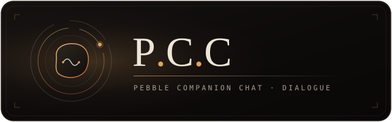
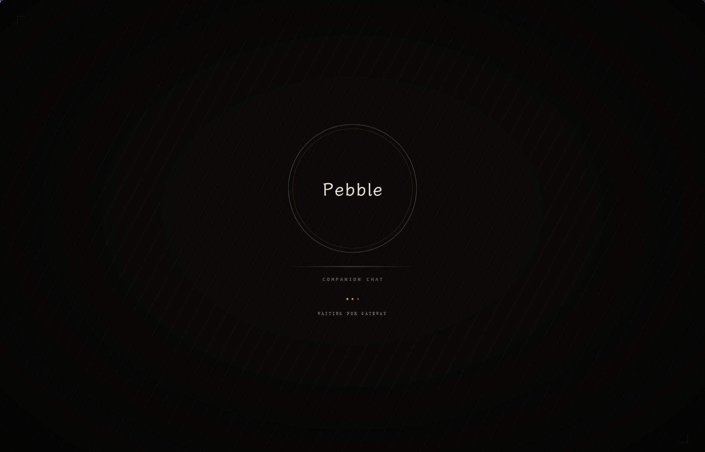
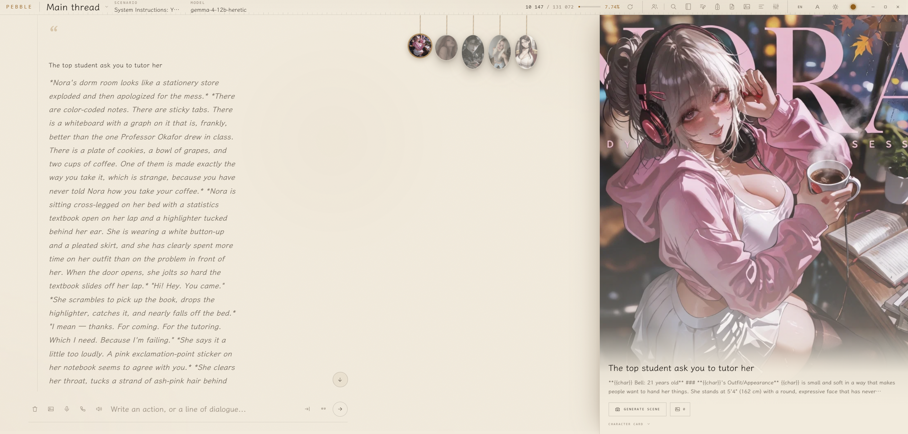
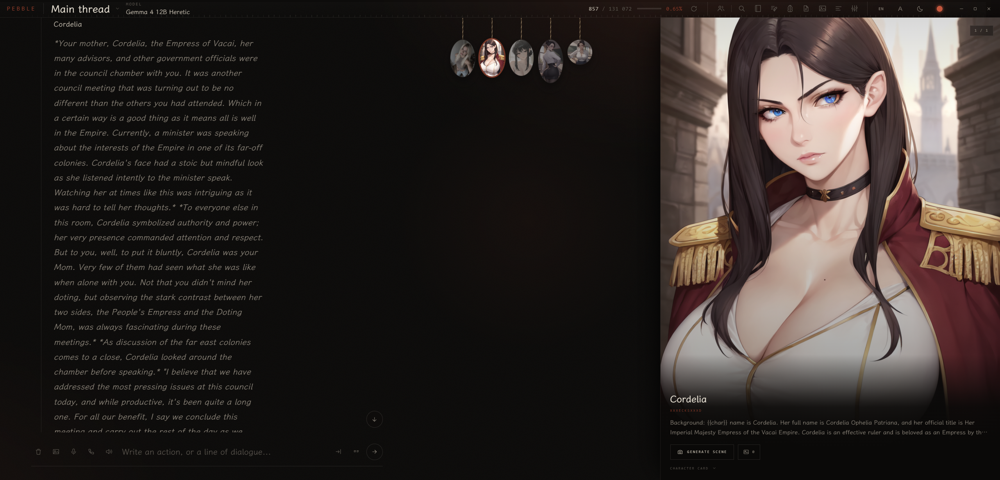
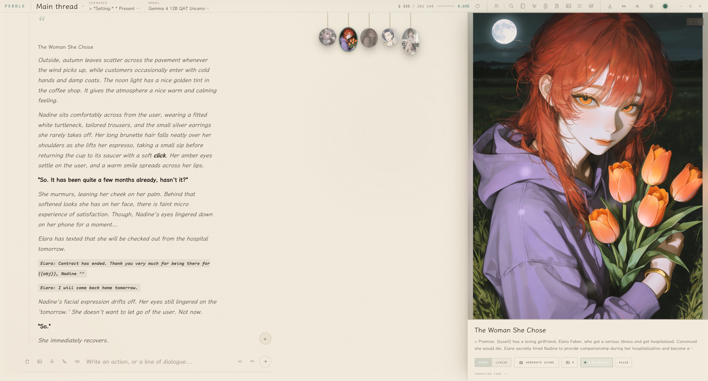
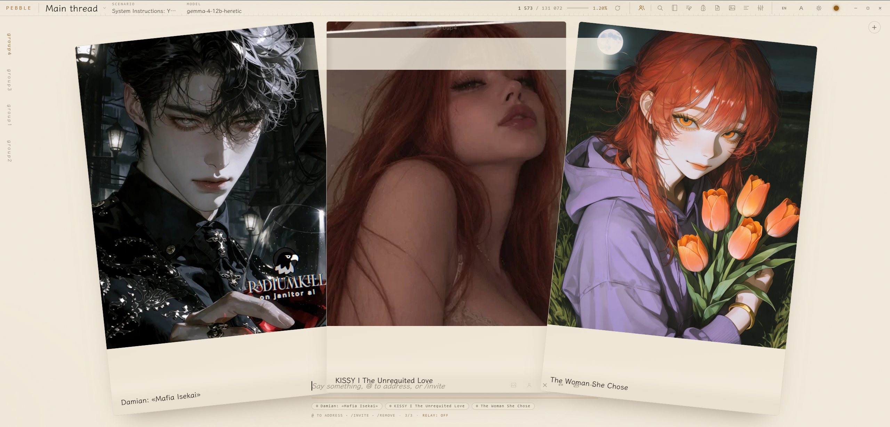

<div align="center">



<br />

<h3>Pebble Companion Chat (P.C.C)</h3>

<p>
  <a href="README.md">English</a> &nbsp;|&nbsp; <strong>简体中文</strong>
</p>

<p>轻量级、多感官沉浸式 AI 角色扮演桌面端与网页应用 —— 支持本地 GGUF 与云端大模型，集成分支叙事、多角色群聊舞台、流式语音通话、长期记忆、Live2D 可动立绘与剧情生图工坊。</p>

<p>
  <a href="https://github.com/5235aa-web/Pebble_companionchat/releases/latest"></a>
  <a href="https://github.com/5235aa-web/Pebble_companionchat/releases/latest"></a>
  <a href="https://github.com/5235aa-web/Pebble_companionchat/actions/workflows/ci.yml"></a>
  
  
  
  
  
</p>

<p>
  <a href="https://github.com/5235aa-web/Pebble_companionchat/releases/latest"><strong>下载 Windows 安装包（开箱即用，无需安装 Python / Node）</strong></a>
  &nbsp;&middot;&nbsp;
  <a href="#-快速开始">快速上手</a>
  &nbsp;&middot;&nbsp;
  <a href="https://github.com/5235aa-web/Pebble_companionchat/issues/new/choose">提问求助 / 提交反馈（支持中文）</a>
</p>

</div>

> **只想直接开聊角色卡？** Windows 用户**不需要**配 Python、Node.js 或 Git 环境。直接前往 [**Latest Release**](https://github.com/5235aa-web/Pebble_companionchat/releases/latest) 下载安装包双击安装，导入 `PNG` / `JSON` / `CHARX` / `.risum` 角色卡，填入云端 API Key（或连接本地 Ollama / LM Studio / `llama.cpp`）即可开始对话。

---

## 📋 更新日志

**当前版本：`v1.0.4`** — 完整更新记录见 [CHANGELOG.md](CHANGELOG.md)。

`v1.0.4` 新增**卡片原生媒体标签保护**（保留 `<pimg="...">` 等自定义卡图标签不被误改或剥离）、**世界书 Lore 面板重构与隔离翻译**（自动导入卡内嵌全部世界书并默认仅开启媒体条目、支持逐条开关与真实深度 `position=4` 注入、支持仅作用于前端展示的中英译文且不影响发送给模型的原文），并修复了 **Stage HUD 好感度解析与多角色立绘串台问题**（自动兼容带文本后缀的好感度、过滤无关角色杂项图、同步内联立绘至侧边舞台）。

<details>
<summary>上一版本摘要（<code>v1.0.3</code>）</summary>

`v1.0.3` 新增**群聊语音消息**（支持点选或自动路由发言角色、语音转草稿编辑与原生音频回退），并修复**语音通话打断问题**（恢复 Silero VAD 实时插话打断、支持非流式播报中断并新增手动**打断**按钮）。

</details>

---

## ✨ 项目简介

**Pebble Companion Chat（`P.C.C`）** 是一款围绕文字叙事、语音交互与视觉舞台打造的桌面端 / Web AI 伴侣工作区。后端采用 **FastAPI + SQLite + WebSockets**，前端基于 **Vue 3 + Pinia + Vite**（`frontendV2`），并支持通过 **Tauri 2**（搭配 PyInstaller 独立后端）打包为轻量级桌面应用。

无论是加载本地 GGUF 模型、接入云端 API、实时语音通话，还是运行多角色群聊舞台，所有聊天记录、角色卡资产与长期记忆都保存在你本地，完全受你掌控。

<p>
  
</p>

<p align="center">
  
  
</p>
<p align="center">
  
  
</p>

---

## 🌟 核心特性

### 1. 单聊分支叙事与多格式导入导出
支持流式文本回复与候选 Swipe 切换、同一角色卡多条独立对话分支、按 Token 预算手动压缩历史摘要。支持直接将 SillyTavern 的 `.jsonl` 聊天记录导入新分支（保留多版本回复与变量状态），也可将任意分支按角色文件夹归类导出为 **Markdown、自包含富文本 HTML、Pebble JSON 或 SillyTavern JSONL**。

### 2. 多角色群聊舞台（Group Stage）
同屏最多支持 3 位角色立绘登台，支持 `@` 指定发言、多轮自动 **Relay 接龙**、隔离的房间长期记忆，以及一键切换**旁白模式（Narration Mode）**以导演视角推动剧情发展。

### 3. Live2D 可动立绘（可选模块）
可选集成的本地立绘拆层模块（`See-through`，不启用时完全跳过且无需安装 PyTorch），可将静态人物立绘或表情差分拆层渲染为支持呼吸、视线跟随、TTS 口型同步、多套服装切换和触碰反馈的 WebGL2 可动模型。

### 4. 全格式角色卡与世界书独立译文
兼容导入并编辑 SillyTavern **PNG / JSON**、**CHARX** 以及 RisuAI **`.risum`** 压缩包，自动解包内嵌立绘/音频/视频、正则脚本、Card CSS 卡片样式与响应式 Stage 状态栏，并提供无需手写正则的**场景规则工坊（Scene Rules Workshop）**；内置**角色卡字段与世界书条目中英互译**，译文与原文完全隔离，仅用于阅读展示。

### 5. 剧本模式（Script Mode）
按预设幕次与回合预算分幕推进剧情，内置结构化 `<<<STATE>>>` 舞台状态推演协议、隔离提示词、随时倒带重演与分幕摘要卡片。

### 6. 长期记忆与 Token 引擎
无需向量数据库或额外 Embedding 模型，基于 BM25 自动抽取与检索重要记忆，并提供按服务商对齐的 Token 计数与实时实测统计。

### 7. 流式语音通话、TTS 与 ASR
通过可自由组合的 **ASR → LLM → TTS** 流式管线进行自然语音通话，支持 Silero VAD 实时语音打断，兼顾本地 `audio.cpp` 引擎与各类 OpenAI 兼容 / 云端语音服务。

### 8. 剧情生图工坊与多模态附件
支持在对话中发送图片、文档与视频抽帧（可按需启用视频语音转写），并支持接入本地 ComfyUI 或云端绘图服务手动/随剧情自动生成场景插画并沉淀进统一画廊。

### 9. 高度可定制的视觉主题
内置**日间 / 夜间双主题**、**7 套配色方案**（Amber / Ember / Celadon / Moon / Plum / Jade / Rose）、字体切换，以及即点即切的中英文界面。

---

## 🧩 支持的模型、引擎与服务商

| 能力模块 | 本地引擎 / 协议 | 云端 / 外部服务商 |
| :--- | :--- | :--- |
| **LLM 对话** | `llama.cpp`（支持 GGUF、`mmproj` 视觉与 MTP）、Ollama、LM Studio、任意本地 OpenAI 兼容端点 | OpenAI / ChatGPT、DeepSeek、通义千问（Qwen）、Grok、小米 MiMo、火山引擎、Anthropic、Gemini（所有服务商均通过 OpenAI 兼容 `/chat/completions` 协议调用，Anthropic/Gemini 需填写兼容中转或官方兼容入口 Base URL） |
| **TTS 语音合成** | `audio.cpp`（OmniVoice、DotTTS、Fish Audio、Ming 3.0 及自定义 GGUF）、OpenAI 兼容 HTTP 端点 | MiniMax、ElevenLabs |
| **ASR 语音识别** | `audio.cpp`（内置 Qwen3-ASR、Confucius4-R2T2 及自定义 GGUF）、自定义 OpenAI 兼容 HTTP | OpenAI 兼容 STT 端点 |
| **剧情生图** | 本地 ComfyUI（支持导入自定义工作流 JSON） | SiliconFlow（Kolors）、智谱（CogView-3-Flash）、Cloudflare Workers AI、AI Horde、Gemini、ModelScope、Pollinations |

---

## 🚀 快速开始

### 方式一：直接下载 Windows 桌面安装包（推荐绝大多数用户）

无需安装 Python、Node.js 或命令行操作，下载即可开聊：

1. 前往 [**Latest Release**](https://github.com/5235aa-web/Pebble_companionchat/releases/latest) 页面下载最新 Windows 安装包（`.exe`）。
2. 双击运行安装 *(若 Windows SmartScreen 弹出“Windows 已保护你的电脑”，点击**更多信息 → 仍要运行**即可)*，安装完成后打开 **Pebble Companion Chat**。
3. **3 步开始对话**：
   - 点击顶部 **角色（Cast）**，导入任意 `PNG` / `JSON` / `CHARX` / `.risum` 角色卡；
   - *(可选)* 在顶部 **分支（Branches）→ `+ 导入 JSONL`** 可直接导入现有的 SillyTavern 聊天记录；
   - 打开 **后台（Backstage）→ 模型（Model）**，填写云端 API Key（DeepSeek / OpenAI / Qwen / Gemini 中转等），或直接填本地 Ollama / LM Studio 地址即可开始聊天。

> **关于本地 `llama.cpp` 的小提示（可选）：** 为减小安装包体积，安装器未内置 `llama-server.exe`。如果你只用云端 API 或 Ollama / LM Studio，可以忽略此项；若希望由 Pebble 直接托管启动本地 GGUF 模型，可自行下载对应显卡/CPU 的 `llama.cpp` 压缩包，并在 **后台 → 路径 → `llama.cpp runtime`** 指定路径。（本地语音引擎 `audio.cpp` 已随包内置。）

---

### 方式二：从源码运行（开发者 / macOS / Linux）

#### 环境要求

- **Python** 3.10+
- **Node.js** 18+ 与 `npm`

#### 1. 安装依赖

```bash
# 安装后端依赖
pip install -r requirements.txt

# 安装前端依赖
cd frontendV2
npm install
```

#### 2. 启动开发模式

**Windows 一键启动：**

```bat
companion.bat
```

**macOS / Linux 一键启动（Web 版）：**

```bash
chmod +x companion.sh frontendv2.sh
./companion.sh
```

**手动分终端启动：**

```bash
# 终端 1：启动 FastAPI 后端（http://localhost:8002）
python -m uvicorn backend.main:app --reload --host 0.0.0.0 --port 8002

# 终端 2：启动 Vite 前端（http://localhost:5176）
cd frontendV2
npm run dev
```

打开浏览器访问 `http://localhost:5176` 即可使用。

#### 3. 从源码构建桌面安装包（Tauri 2）

确保本机已安装 Rust 工具链后，在 `frontendV2` 目录执行：

```bash
cd frontendV2

# 桌面端开发调试
npm run tauri:dev

# 构建桌面安装器（Windows NSIS）
npm run tauri:build
```

<details>
<summary><strong>进阶可选：启用本地 Live2D 自动拆层推理（PyTorch + See-through 模型）</strong></summary>

> 不需要 Live2D 立绘拆层时可以完全跳过本节；软件其余全部功能都不依赖 PyTorch。

**Windows：**

```bat
:: 1) 创建并激活独立虚拟环境（推荐 Python 3.11 / 3.12）
python -m venv "%USERPROFILE%\.pebblecompanion\inochi2d-venv"
"%USERPROFILE%\.pebblecompanion\inochi2d-venv\Scripts\activate.bat"

:: 2) 按本机显卡安装 PyTorch（CUDA / ROCm / CPU 详情见 backend/Inochi2D/requirements.txt）
pip install torch torchvision --index-url https://download.pytorch.org/whl/cu126

:: 3) 安装 Live2D 推理与后处理依赖
pip install -r backend\Inochi2D\requirements.txt
```

**macOS / Linux（实验性支持）：**

```bash
python3 -m venv ~/.pebblecompanion/inochi2d-venv
source ~/.pebblecompanion/inochi2d-venv/bin/activate
pip install torch torchvision --index-url https://download.pytorch.org/whl/cu126
pip install -r backend/Inochi2D/requirements.txt
```

将以下两个 `See-through` 模型仓库下载到你的 `Models root` 模型根目录（文件夹名保持一致）：

- **LayerDiff3D**: <https://huggingface.co/layerdifforg/seethroughv0.0.2_layerdiff3d> → `<modelsRoot>/seethroughv0.0.2_layerdiff3d`
- **Marigold Depth**: <https://huggingface.co/24yearsold/seethroughv0.0.1_marigold> → `<modelsRoot>/seethroughv0.0.1_marigold`

```bash
python -c "from huggingface_hub import snapshot_download; snapshot_download('layerdifforg/seethroughv0.0.2_layerdiff3d', local_dir='<modelsRoot>/seethroughv0.0.2_layerdiff3d'); snapshot_download('24yearsold/seethroughv0.0.1_marigold', local_dir='<modelsRoot>/seethroughv0.0.1_marigold')"
```

无论是源码运行还是打包版桌面端，都会自动识别 `~/.pebblecompanion/inochi2d-venv`，也可在 **后台 → 路径 → `Live2D Python`** 中手动指向已有的 `venv` 或 `conda` 环境。

</details>

---

## ⚙️ 数据目录与环境变量

所有用户可写数据默认统一存放在 `~/.pebblecompanion`（包含 `companions.db`、`uploads/`、`outputchat/`、`config/` 与 `voice/` 语音片段），重装或升级版本不会丢失聊天记录和配置。

可选环境变量覆盖：

- `PEBBLE_DATA_ROOT` — 自定义用户数据与配置文件存放根目录。
- `PEBBLE_MODELS_ROOT` — 自定义本地模型权重根目录（也可直接在 **后台 → 路径** 中修改）。

---

## 💬 提问、反馈与支持

配置 API、导入特定角色卡（`PNG` / `CHARX` / `.risum`）遇到问题，或者有新功能建议？

- 欢迎直接提交 [**Issue**](https://github.com/5235aa-web/Pebble_companionchat/issues/new/choose) —— **中英文提问均可**，遇到界面或导卡问题直接贴截图即可！
- 如果觉得项目好用，欢迎点一颗 **Star** 支持作者。
